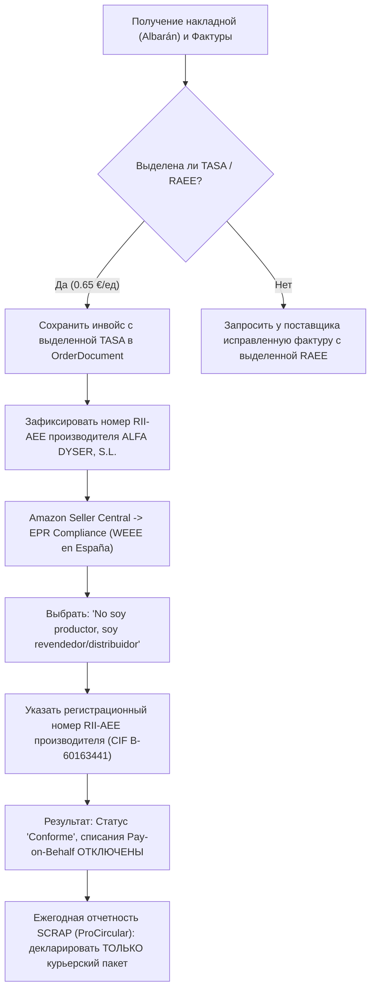

# Навык: Приемка товара от поставщика (Goods Receiving & Inventory WMS)

Этот навык регламентирует пошаговый процесс физической приемки входящих поставок от официальных дистрибьюторов (например, **ALFA DYSER, S.L.**), контроль вложений, проведение рулеточных замеров и взвешивания, фотофиксацию, автоматическое распределение остатков между **Складом временного хранения (СВХ)** и **Основным складом (MAIN)**, учет документов (*Albarán*, фактуры) и сквозной расчет юнит-экономики партии в единой базе данных.

---

## 🏢 Архитектура двух складов и логика буфера СВХ

В системе организовано четкое разделение складских зон:
1. **СВХ (Склад временного хранения / оперативный буфер FBM)**:
   - Рабочий склад, с которого производятся ежедневные упаковка и отправка заказов покупателям на маркетплейсах (Amazon FBM).
   - **Правило по умолчанию при приемке**: на СВХ кладется **3 штуки** каждого принятого артикула (или всё количество, если принято меньше 3).
   - **Порог предупреждения (`minStockAlert = 1`)**: как только после очередного списания продажи на Amazon остаток на СВХ опускается до **1 шт** (или 0), система немедленно формирует **алерт пополнения** с рекомендацией перевезти очередные 3 шт с Основного склада.
2. **MAIN (Основной склад / длительное хранение)**:
   - Склад для хранения основного объема партии (например, 7 штук из 10).
   - Используется для периодической подпитки буфера СВХ по мере исчерпания оперативного запаса.
3. **FBA (Склад Amazon FBA)**:
   - Зарезервирован под оптовые отправки коробок на фулфилмент-центры маркетплейса Amazon.

---

## 📋 Двухфазный пошаговый регламент приемки товара (Партия целиком -> Позиции по отдельности)

Процедура приемки (включая интерактивную приемку в Telegram через OpenClaw и CLI) **строго разделена на две логические фазы**: сначала проводится общая приемка всей партии и сопроводительных документов (Фаза 1), а затем — последовательная приемка каждой отдельной товарной позиции (Фаза 2).

### Предварительный шаг. Открытие чек-листа поставки (или проверка прошлой приемки для корректировки)
При получении коробок от курьера (например, 2 грузовых места от DHL) вызовите команду проверки ожидаемого состава (или `GET http://backend:3000/orders/<orderNumber>`):
```bash
cd ecommerce/backend && npx tsx scripts/receive-shipment.ts --order "26ALV-0074072" --check
```
- Если партия **еще не принималась** (`CONFIRMED` / `SHIPPED`) — открывается первичный чек-лист приемки.
- Если по партии **уже проводилась приемка** (`RECEIVED` или `PARTIALLY_RECEIVED`) — система отображает ранее принятые количества, замеры и комментарии и переходит в **режим корректировки приемки (Delta Correction)**. При повторном прохождении процедуры остатки на складах `SVH` и `MAIN` пересчитываются строго по разнице (дельте) без задвоения!

---

### ФАЗА 1. Приемка всей партии в целом (Batch-Level Receiving)

#### 1.1. Запрос даты фактического получения и даты проведения приемки
Так как физическая приемка и вскрытие коробок могут проводиться с опозданием относительно дня вручения посылки курьером, **обязательно запрашиваются и фиксируются две даты**:
1. **Дата фактического получения (`actualDeliveryDate`)** — день, когда курьер доставил коробки на склад.
2. **Дата проведения приемки (`receivingDate`)** — день, когда фактически производятся вскрытие, пересчет и замеры.

#### 1.2. Проверка обязательного списка документов поставки (с правом явного пропуска по причине)
Приемка документов идет строго по утвержденному списку (`RECEIVING_DOCUMENT_CHECKLIST`):
1. **`ALBARAN` (Товарно-транспортная накладная поставщика)**:
   - Проверка перечня артикулов (SKU), штрихкодов EAN и отгруженного количества.
   - Проверка наличия выделенной строки экологического сбора **`TASA` / `RAEE`** (например, **0.65 €/шт** у ALFA DYSER), включенной в базу перед начислением IVA 21% + RE 5.2% (коэффициент 1.262).
2. **`SHIPPING_LABEL` (Транспортная этикетка курьерской службы)**:
   - Фото наклейки перевозчика (DHL, SEUR, Correos Express) на транспортных коробах с трек-номером и числом грузовых мест (`Bulto 1/2`, `2/2`).
3. **`INVOICE` (Счет-фактура / `Factura` поставщика)**:
   - Проверка налоговой базы Netto, налогов IVA 21% + RE 5.2%, суммы TASA и регистрационного номера производителя в реестре **RII-AEE** / CIF (`B-60163441` для ALFA DYSER, S.L.).
   - **Обязательное правило Taxfix**: при получении каждой фактуры она должна быть загружена в налоговый сервис **Taxfix**, к ней обязательно прикрепляется факт оплаты из банка (`PAYMENT_RECEIPT`), и фактура линкуется с оплатой внутри **Taxfix** (контролируется задачей `[Legal]` в Google Tasks и эндпоинтом `POST /orders/:id/taxfix`).
4. **`PAYMENT_RECEIPT` (Подтверждение оплаты / SEPA Direct Debit / Выписка из банка)**:
   - Квитанция об оплате из банка (выписка по карте, переводу или SEPA Direct Debit), обязательная для прикрепления к каждой фактуре и линковки в сервисе **Taxfix**.

> **Правило пропуска документа (`skippedDocuments`)**: Агент обязан идти строго по списку документов. Если какого-либо документа на момент приемки нет (например, счет-фактура `Factura` выставляется поставщиком позже по email), допускается **явное разрешение пользователя на пропуск документа с обязательным указанием причины** (например: *"Пропускаем фактуру, поставщик пришлет на email в конце месяца"*). Причина пропуска обязательно записывается в `skippedDocuments` и в комментарий приемки заказа.

#### 1.3. Фотографирование всей партии целиком (общие коробки с разных сторон)
До вскрытия и в момент вскрытия транспортной тары выполняются **общие фотографии всей партии**:
- Фото всех прибывших транспортных коробок (грузовых мест) с разных сторон (спереди, сбоку, сверху).
- Фото выявленных внешних повреждений транспортных коробов (вмятины, порывы скотча, следы влаги).
- Все выявленные на этом этапе моменты и описания фотографий фиксируются в **общем комментарии приемки партии** (`receivingNotes` / `notes`).

---

### ФАЗА 2. Поштучная приемка каждой отдельной позиции (Item-by-Item Receiving)

После завершения общей приемки партии процедура переходит к **каждой позиции заказа по отдельности**:

#### 2.1. Обязательная тройная сверка штрихкода EAN (Triple EAN Verification)
По каждому принимаемому артикулу **строго обязательно** сверяются между собой три источника EAN:
1. **EAN из заказа в БД** (`PurchaseOrderItem.ean`),
2. **EAN из бумажной накладной `Albarán`** (`eanAlbaran`),
3. **EAN со штрихкода на физической заводской коробке товара** (`eanBox`).
- Если все 3 кода совпадают — в комментарии позиции фиксируется: `✅ Тройная сверка EAN пройдена (Заказ = Albarán = Коробка)`.
- Если обнаружено расхождение хотя бы в одном источнике — система формирует предупреждение `⚠️ НЕСООТВЕТСТВИЕ EAN` и обязательно записывает детали расхождения в комментарий приемки!

#### 2.2. Фактический пересчет количества и осмотр состояния
- Пересчитайте физическое количество заводских коробок данного артикула (`quantityReceived`) и сверьте с заказанным (`quantityOrdered`).
- Осмотрите каждую индивидуальную коробку на предмет повреждений.

#### 2.3. Фотографирование отдельного айтема с разных сторон
Помимо общих фото партии, для **каждого отдельного артикула** обязательно делаются индивидуальные фотографии (привязываются к позиции `purchaseOrderItemId`):
1. **Фото заводской коробки айтема с разных сторон** (лицевая сторона, оборотная сторона, боковые грани).
2. **Фото крупным планом штрихкода EAN-13 и экологической маркировки WEEE** (знак перечеркнутого мусорного бака).
3. **Фото самого товара** (при контрольном вскрытии).
4. **Фото физических замеров рулеткой (Длина, Ширина, Высота) и взвешивания на весах**.

#### 2.4. Замеры габаритов, взвешивание и проверка входимости в курьерский пакет
1. **Замеры упаковки рулеткой**:
   - Замерьте габариты заводской коробки товара: **Длина**, **Ширина**, **Высота** (в сантиметрах).
   - *Критически важно*: подтвердить свободный вход заводской коробки в закупленные курьерские пакеты $40 \times 50\text{ см}$ (поставщик упаковки [EMBALAJE24, S.L.](file:///Users/usuario/code/viasglobal/ecommerce/contractors/embalaje24/README.md)) перед отправкой покупателям.
2. **Взвешивание**:
   - Взвесьте 1 упакованную единицу товара на весах и зафиксируйте вес в **граммах** (брутто).

#### 2.5. Запись всех фото и выявленных моментов в комментарий приемки и распределение СВХ / MAIN
- **Все пересылаемые фотографии и любые выявленные моменты** (потертости, замятия углов, расхождения по количеству или штрихкоду) обязательно записываются в комментарий приемки позиции (`itemNotes`) и партии (`receivingNotes`).
- Определяется распределение принятого количества между складами:
  * **СВХ (`SVH`)**: по дефолту **3 шт** (оперативный буфер FBM).
  * **Основной склад (`MAIN`)**: остальное количество (например, **7 шт** из 10).

---

### Шаг 3. Фиксация приемки (или корректировки приемки) в БД

Выполните команду фиксации приемки (или вызовите `POST /orders/:id/receive` / `PATCH /orders/:id/receive`):
```bash
cd ecommerce/backend && npx tsx scripts/receive-shipment.ts --order "26ALV-0074072" \
  --delivery-date "2026-10-26" \
  --receiving-date "2026-10-29" \
  --skip-doc "INVOICE:Фактура будет выслана поставщиком по email в конце месяца" \
  --batch-photos "../contractors/kuken/attachments/albaran_photo.jpg,../contractors/kuken/attachments/batch_boxes.jpg" \
  --notes "Два короба DHL, внешний короб #2 слегка замят сбоку, внутри всё целое" \
  --item "34316:10:28:10:22:850:3:7" \
  --ean-check "34316:8425160343163:8425160343163" \
  --item-photos "34316:../contractors/kuken/attachments/secador_front.jpg,../contractors/kuken/attachments/secador_side_ean.jpg" \
  --item-notes "34316:Коробки целые, входит в пакет 40x50 см" \
  --item "35536:10:30:12:16:1200:3:7" \
  --ean-check "35536:8425160355364:8425160355364" \
  --item-photos "35536:../contractors/kuken/attachments/plancha_front.jpg,../contractors/kuken/attachments/plancha_side_ean.jpg" \
  --item-notes "35536:Упаковка без повреждений"
```

Скрипт и REST API автоматически:
- Запишут дату получения (`actualDeliveryDate`) и дату приемки (`receivingDate`).
- Сохранят результаты тройной сверки EAN, пропущенные документы с причинами и все комментарии по партии и каждой позиции.
- Прикрепят общие фотографии к партии (`purchaseOrderId`), а поштучные фотографии с разных сторон — к конкретным позициям (`purchaseOrderItemId`).
- При **первичной приемке** — оприходуют **3 шт на склад СВХ** и **7 шт на склад MAIN** (`StockMovementType.RECEIPT`).
- При **повторной приемке (корректировке)** по уже принятой партии — вычислят точную дельту (`deltaSvh`, `deltaMain`) относительно ранее оприходованного количества, обновят замеры/комментарии/фото без дублирования остатков и создадут корректирующие проводки `ADJUSTMENT` только при фактическом изменении количества!

---

## 📊 Аналитика юнит-экономики партии и сквозная прослеживаемость

### Просмотр всех заказов поставщика
Чтобы увидеть все заказы и поставки конкретного поставщика:
```bash
cd ecommerce/backend && npx tsx scripts/orders.ts --distributor "ALFA DYSER" --list
```

### Просмотр детальной карточки заказа и юнит-экономики
Чтобы открыть полную финансовую сводку партии, себестоимость с налогами (RE 1.262), розничные цены BuyBox, комиссии Amazon и расчетную прибыль:
```bash
cd ecommerce/backend && npx tsx scripts/orders.ts --order "26ALV-0074072"
```

---

## 🔄 Складской учет, продажи и пополнение буфера СВХ

### Просмотр текущих остатков на складах
```bash
cd ecommerce/backend && npx tsx scripts/inventory.ts --stocks
# Либо отдельно по складу:
cd ecommerce/backend && npx tsx scripts/inventory.ts --stocks --warehouse SVH
```

### Регистрация продажи на Amazon (списание с СВХ)
Когда на Amazon поступает заказ покупателя, продажа регистрируется командой:
```bash
cd ecommerce/backend && npx tsx scripts/record-sale.ts \
  --order "402-1234567-8901234" \
  --sku "34316" \
  --qty 1 \
  --price 26.70 \
  --fee 4.01 \
  --shipping 4.50 \
  --city "Valencia"
```
- Скрипт списывает 1 шт со склада СВХ.
- Связывает продажу с партией закупки через `BatchSalesAllocation` (FIFO).
- Рассчитывает фактическую чистую прибыль: $\text{netProfit} = 26.70 - 4.01 - 4.50 - 15.74 = +2.45\ €$.
- **АВТОМАТИЧЕСКИЙ АЛЕРТ**: если остаток на СВХ стал $\le 1$ шт, скрипт выводит звуковое/текстовое предупреждение о необходимости пополнения СВХ с Основного склада!

### Проверка алертов окончания товара на СВХ
```bash
cd ecommerce/backend && npx tsx scripts/inventory.ts --alerts
```

### Оформление перемещения с Основного склада на СВХ
Когда на СВХ остался 1 товар, пополните буфер оперативной отправки командой:
```bash
cd ecommerce/backend && npx tsx scripts/inventory.ts --transfer --sku 34316 --from MAIN --to SVH --qty 3
```

---

## 🔍 Сквозная трассировка: куда и кому была продана партия
Вы можете в любой момент посмотреть историю продаж конкретной партии:
```bash
# Через REST API:
curl -s http://backend:3000/sales/trace-batch/26ALV-0074072
```
Система покажет, какие именно серийные номера и единицы партии ушли в какие заказы Amazon, города доставки покупателей и какую суммарную чистую прибыль принесла партия.

---

## 🌿 Контроль эко-тасы (Canon RAEE) и защита от повторной оплаты (Anti-Double Payment Protocol)

### 1. Юридическая основа
- В Испании утилизация электроники и бытовой техники регулируется Королевским указом **Real Decreto 110/2015** (*sobre residuos de aparatos eléctricos y electrónicos — RAEE*).
- Первичным плательщиком сбора является производитель или импортер, впервые вводящий товар в оборот в Испании. Для бренда **KUKEN** правообладателем и производителем является **ALFA DYSER, S.L.** (CIF `B-60163441`).
- При закупке поставщик выделяет сбор отдельной строкой: `TASA = 0.65 €` на единицу товара.
- В соответствии со ст. 78 Закона об НДС (*Ley 37/1992 del IVA*) эко-таса включается в налогооблагаемую базу, и с нее начисляются IVA (21%) и Recargo de Equivalencia (5.2%).
- **Вывод**: Мы **уже уплатили эко-тасу в полном объеме** поставщику при закупке партии (13.00 € за 20 единиц).

### 2. Риск повторной оплаты
Маркетплейсы (Amazon Spain) в рамках регламента **EPR (Extended Producer Responsibility / Responsabilidad Ampliada del Productor)** требуют подтверждения утилизации.
Если продавец не подтвердит статус товара, Amazon:
1. Автоматически активирует услугу **Amazon Pay on Behalf** и начинает **списывать повторный эко-сбор с каждой продажи** товара на маркетплейсе (0.65–1.00 € с каждого проданного фена или утюга), удерживая деньги из выплат.
2. Либо блокирует карточки товаров (ASIN) за несоблюдение норм EPR / WEEE.

### 3. Пошаговый алгоритм: Как НЕ платить эко-тасу повторно



#### Шаг 1. Документальное подтверждение уплаты (Prueba Documental)
- При проверке документов поставки (Шаг 2 чек-листа) убедитесь, что в официальной фактуре (*Factura*) и накладной (*Albarán*) экологический сбор указан явно: `TASA: 0.65 €`.
- Сохраните скан или фото накладной в папку `ecommerce/contractors/kuken/attachments/` и прикрепите к заказу через скрипт `receive-shipment.ts` (документ типа `ALBARAN` / `INVOICE`).
- Данный документ служит официальным доказательством (*factura desglosada*) того, что сбор уже был внесен в систему переработки при первой продаже в Испании.

#### Шаг 2. Защита от списаний Amazon Pay on Behalf (Seller Central EPR)
Чтобы Amazon не начислял повторный сбор за утилизацию на каждую продажу:
1. Откройте **Amazon Seller Central**: `Desempeño (Performance) -> Estado de la cuenta (Account Health) -> Cumplimiento de normativas -> Responsabilidad ampliada del productor (EPR)`.
2. Найдите категорию: **Aparatos eléctricos y electrónicos (AEE / WEEE) en España**.
3. В графе роли выберите: **«No soy productor (Soy distribuidor / revendedor)»** («Я не производитель, а дистрибьютор/реселлер»).
4. В поле «Número de registro del productor» укажите **номер регистрации в реестре RII-AEE производителя ALFA DYSER, S.L.** (или CIF `B60163441` компании-производителя бренда KUKEN).
5. Если Amazon запросит проверку документов (Audit / Verification), прикрепите сохраненную фактуру поставщика от ALFA DYSER с выделенной строкой `TASA`.
6. После одобрения листинги получают статус **Cumple (Compliant)**, а повторные списания *Pay on Behalf* навсегда блокируются!

#### Шаг 3. Исключение электроники из ежегодных деклараций упаковки (SCRAP / ProCircular)
- При подаче ежегодной декларации в систему коллективной ответственности (SCRAP, например, **ProCircular**):
  - Декларируется **ТОЛЬКО вторичная курьерская упаковка**, которую мы добавляем сами при упаковке заказов FBM (курьерские пакеты $40 \times 50$ см от EMBALAJE24, скотч, термоэтикетки).
  - Сам электроприбор и его заводская коробка **НЕ декларируются повторно**, так как производитель ALFA DYSER, S.L. уже задекларировал и оплатил их в своем SCRAP (ECOTIC) как первичный ввод на рынок Испании.

#### Шаг 4. Контроль в юнит-экономике Viasglobal
- В системе WMS и в скриптах `orders.ts` / `receive-shipment.ts` эко-таса учитывается в стоимости закупки `costPrice` (с коэффициентом RE 1.262), а в комиссии продаж Amazon удерживаемая комиссия WEEE фиксируется равной **0.00 €**, сохраняя максимальную чистую маржинальность.
