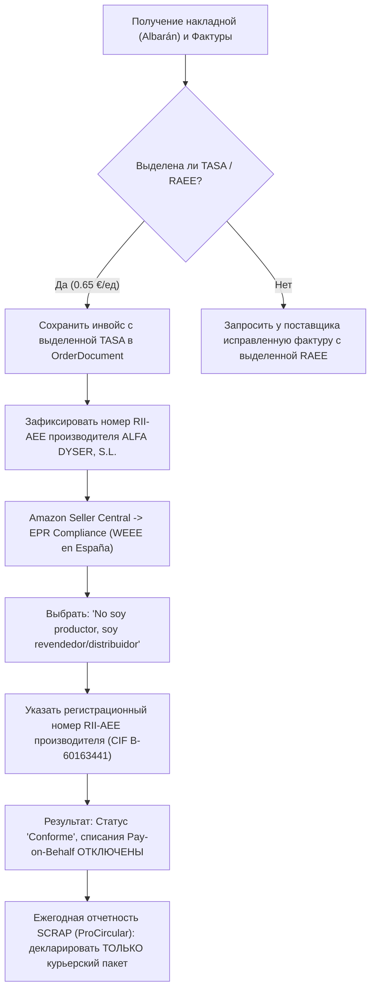

# Навык: Приемка товара от поставщика (Goods Receiving & Inventory WMS)

Этот навык регламентирует пошаговый процесс физической приемки входящих поставок от официальных дистрибьюторов (например, **ALFA DYSER, S.L.**), контроль вложений, проведение рулеточных замеров и взвешивания, фотофиксацию, автоматическое распределение остатков между **Складом временного хранения (СВХ)** и **Основным складом (MAIN)**, учет документов (*Albarán*, фактуры) и сквозной расчет юнит-экономики партии в единой базе данных.

---

## 🏢 Архитектура двух складов и логика буфера СВХ

В системе организовано четкое разделение складских зон:
1. **СВХ (Склад временного хранения / оперативный буфер FBM)**:
   - Рабочий склад, с которого производятся ежедневные упаковка и отправка заказов покупателям на маркетплейсах (Amazon FBM).
   - **Правило по умолчанию при приемке**: на СВХ кладется **3 штуки** каждого принятого артикула (или всё количество, если принято меньше 3).
   - **Порог предупреждения (`minStockAlert = 1`)**: как только после очередного списания продажи на Amazon остаток на СВХ опускается до **1 шт** (или 0), система немедленно формирует **алерт пополнения** с рекомендацией перевезти очередные 3 шт с Основного склада.
2. **MAIN (Основной склад / длительное хранение)**:
   - Склад для хранения основного объема партии (например, 7 штук из 10).
   - Используется для периодической подпитки буфера СВХ по мере исчерпания оперативного запаса.
3. **FBA (Склад Amazon FBA)**:
   - Зарезервирован под оптовые отправки коробок на фулфилмент-центры маркетплейса Amazon.

---

## 📋 Пошаговый регламент приемки товара

### Шаг 1. Открытие чек-листа поставки по Albarán
При получении коробок от курьера (например, 2 грузовых места от DHL) и обнаружении вложенной накладной (*Albarán*) вызовите команду проверки ожидаемого состава:
```bash
cd backend && npx tsx scripts/receive-shipment.ts --order "26ALV-0074072" --check
```
Скрипт выведет таблицу с перечнем ожидаемых артикулов (SKU), штрихкодов EAN, связанных ASIN Amazon, заказанных количеств и эталонных закупочных цен.

### Шаг 2. Контроль документов и проверка эко-тасы (TASA RAEE)
При проверке вложенного бумажного *Albarán* и фактуры поставщика:
1. **Проверьте наличие колонки или строки `TASA` / `RAEE`**:
   - Для бытовой электроники (PAE, фены, утюги) сбор составляет фиксированную сумму за единицу (например, **0.65 €/шт** у ALFA DYSER).
   - Убедитесь, что эко-таса выделена в документе отдельной суммой и включена в налогооблагаемую базу (*Base Imponible*) перед начислением IVA 21% и Recargo de Equivalencia 5.2% (коэффициент 1.262) согласно ст. 78 Ley 37/1992 del IVA.
2. **Проверьте регистрацию производителя в RII-AEE**:
   - На документе или в реквизитах поставщика должен быть указан регистрационный номер в государственном реестре производителей Министерства промышленности Испании (*Registro Integrado Industrial de Aparatos Eléctricos y Electrónicos* — **RII-AEE**) либо наименование коллективной системы утилизации SCRAP (ECOTIC / ECOASIMELEC).
   - Для KUKEN производителем является **ALFA DYSER, S.L.** (CIF `B-60163441`).

### Шаг 3. Вскрытие коробок и фактический пересчет
- Вскройте транспортные короба и пересчитайте физическое количество заводских упаковок по каждому артикулу.
- Убедитесь в отсутствии механических повреждений коробок.
- Сверьте штрихкод **EAN-13** на заводской коробке с номером в накладной.

### Шаг 4. Физические замеры и фотофиксация
1. **Замеры упаковки рулеткой**:
   - Замерьте габариты заводской коробки товара: **Длина**, **Ширина**, **Высота** (в сантиметрах).
   - *Критически важно*: подтвердить свободный вход заводской коробки в закупленные курьерские пакеты $40 \times 50\text{ см}$ (поставщик упаковки [EMBALAJE24, S.L.](file:///Users/usuario/code/viasglobal/contractors/embalaje24/README.md)) перед отправкой покупателям.
2. **Взвешивание**:
   - Взвесьте 1 упакованную единицу товара на весах и зафиксируйте вес в **граммах** (брутто).
3. **Фотофиксация**:
   - Сделайте фото вложенного бумажного *Albarán* (особенно блок с суммами и строкой `TASA`).
   - Сделайте фото заводской коробки с читаемым EAN-штрихкодом и маркировкой перечеркнутого мусорного бака (знак WEEE).
   - Сделайте фото товара и замеров рулеткой.
   - Сохраните фотографии в папку `contractors/<дистрибьютор>/attachments/` (например, `contractors/kuken/attachments/`).

### Шаг 5. Проведение приемки и оприходование в БД
Выполните команду фиксации фактической приемки, передав фактические количества, замеры и пути к фото:
```bash
cd backend && npx tsx scripts/receive-shipment.ts --order "26ALV-0074072" \
  --item "34316:10:28:10:22:850:3:7" \
  --item "35536:10:30:12:16:1200:3:7" \
  --photos "contractors/kuken/attachments/albaran_photo.jpg,contractors/kuken/attachments/secador_box.jpg"
```
**Формат параметра `--item`**:
`"<SKU>:<кол_во_принято>:<длина_см>:<ширина_см>:<высота_см>:<вес_грамм>:<шт_на_СВХ>:<шт_на_MAIN>"`

Скрипт автоматически:
- Обновит позиции заказа `PurchaseOrderItem`: запишет принятое количество, замеры и вес.
- Оприходует **3 шт на склад СВХ** и **7 шт на склад MAIN** в таблице `WarehouseStock`.
- Зафиксирует операции `RECEIPT` в журнале `StockMovement`.
- Прикрепит фотографии к партии в таблице `OrderDocument`.
- Переведет статус заказа в `RECEIVED`.

---

## 📊 Аналитика юнит-экономики партии и сквозная прослеживаемость

### Просмотр всех заказов поставщика
Чтобы увидеть все заказы и поставки конкретного поставщика:
```bash
cd backend && npx tsx scripts/orders.ts --distributor "ALFA DYSER" --list
```

### Просмотр детальной карточки заказа и юнит-экономики
Чтобы открыть полную финансовую сводку партии, себестоимость с налогами (RE 1.262), розничные цены BuyBox, комиссии Amazon и расчетную прибыль:
```bash
cd backend && npx tsx scripts/orders.ts --order "26ALV-0074072"
```

---

## 🔄 Складской учет, продажи и пополнение буфера СВХ

### Просмотр текущих остатков на складах
```bash
cd backend && npx tsx scripts/inventory.ts --stocks
# Либо отдельно по складу:
cd backend && npx tsx scripts/inventory.ts --stocks --warehouse SVH
```

### Регистрация продажи на Amazon (списание с СВХ)
Когда на Amazon поступает заказ покупателя, продажа регистрируется командой:
```bash
cd backend && npx tsx scripts/record-sale.ts \
  --order "402-1234567-8901234" \
  --sku "34316" \
  --qty 1 \
  --price 26.70 \
  --fee 4.01 \
  --shipping 4.50 \
  --city "Valencia"
```
- Скрипт списывает 1 шт со склада СВХ.
- Связывает продажу с партией закупки через `BatchSalesAllocation` (FIFO).
- Рассчитывает фактическую чистую прибыль: $\text{netProfit} = 26.70 - 4.01 - 4.50 - 15.74 = +2.45\ €$.
- **АВТОМАТИЧЕСКИЙ АЛЕРТ**: если остаток на СВХ стал $\le 1$ шт, скрипт выводит звуковое/текстовое предупреждение о необходимости пополнения СВХ с Основного склада!

### Проверка алертов окончания товара на СВХ
```bash
cd backend && npx tsx scripts/inventory.ts --alerts
```

### Оформление перемещения с Основного склада на СВХ
Когда на СВХ остался 1 товар, пополните буфер оперативной отправки командой:
```bash
cd backend && npx tsx scripts/inventory.ts --transfer --sku 34316 --from MAIN --to SVH --qty 3
```

---

## 🔍 Сквозная трассировка: куда и кому была продана партия
Вы можете в любой момент посмотреть историю продаж конкретной партии:
```bash
# Через REST API:
curl -s http://backend:3000/sales/trace-batch/26ALV-0074072
```
Система покажет, какие именно серийные номера и единицы партии ушли в какие заказы Amazon, города доставки покупателей и какую суммарную чистую прибыль принесла партия.

---

## 🌿 Контроль эко-тасы (Canon RAEE) и защита от повторной оплаты (Anti-Double Payment Protocol)

### 1. Юридическая основа
- В Испании утилизация электроники и бытовой техники регулируется Королевским указом **Real Decreto 110/2015** (*sobre residuos de aparatos eléctricos y electrónicos — RAEE*).
- Первичным плательщиком сбора является производитель или импортер, впервые вводящий товар в оборот в Испании. Для бренда **KUKEN** правообладателем и производителем является **ALFA DYSER, S.L.** (CIF `B-60163441`).
- При закупке поставщик выделяет сбор отдельной строкой: `TASA = 0.65 €` на единицу товара.
- В соответствии со ст. 78 Закона об НДС (*Ley 37/1992 del IVA*) эко-таса включается в налогооблагаемую базу, и с нее начисляются IVA (21%) и Recargo de Equivalencia (5.2%).
- **Вывод**: Мы **уже уплатили эко-тасу в полном объеме** поставщику при закупке партии (13.00 € за 20 единиц).

### 2. Риск повторной оплаты
Маркетплейсы (Amazon Spain) в рамках регламента **EPR (Extended Producer Responsibility / Responsabilidad Ampliada del Productor)** требуют подтверждения утилизации.
Если продавец не подтвердит статус товара, Amazon:
1. Автоматически активирует услугу **Amazon Pay on Behalf** и начинает **списывать повторный эко-сбор с каждой продажи** товара на маркетплейсе (0.65–1.00 € с каждого проданного фена или утюга), удерживая деньги из выплат.
2. Либо блокирует карточки товаров (ASIN) за несоблюдение норм EPR / WEEE.

### 3. Пошаговый алгоритм: Как НЕ платить эко-тасу повторно



#### Шаг 1. Документальное подтверждение уплаты (Prueba Documental)
- При проверке документов поставки (Шаг 2 чек-листа) убедитесь, что в официальной фактуре (*Factura*) и накладной (*Albarán*) экологический сбор указан явно: `TASA: 0.65 €`.
- Сохраните скан или фото накладной в папку `contractors/kuken/attachments/` и прикрепите к заказу через скрипт `receive-shipment.ts` (документ типа `ALBARAN` / `INVOICE`).
- Данный документ служит официальным доказательством (*factura desglosada*) того, что сбор уже был внесен в систему переработки при первой продаже в Испании.

#### Шаг 2. Защита от списаний Amazon Pay on Behalf (Seller Central EPR)
Чтобы Amazon не начислял повторный сбор за утилизацию на каждую продажу:
1. Откройте **Amazon Seller Central**: `Desempeño (Performance) -> Estado de la cuenta (Account Health) -> Cumplimiento de normativas -> Responsabilidad ampliada del productor (EPR)`.
2. Найдите категорию: **Aparatos eléctricos y electrónicos (AEE / WEEE) en España**.
3. В графе роли выберите: **«No soy productor (Soy distribuidor / revendedor)»** («Я не производитель, а дистрибьютор/реселлер»).
4. В поле «Número de registro del productor» укажите **номер регистрации в реестре RII-AEE производителя ALFA DYSER, S.L.** (или CIF `B60163441` компании-производителя бренда KUKEN).
5. Если Amazon запросит проверку документов (Audit / Verification), прикрепите сохраненную фактуру поставщика от ALFA DYSER с выделенной строкой `TASA`.
6. После одобрения листинги получают статус **Cumple (Compliant)**, а повторные списания *Pay on Behalf* навсегда блокируются!

#### Шаг 3. Исключение электроники из ежегодных деклараций упаковки (SCRAP / ProCircular)
- При подаче ежегодной декларации в систему коллективной ответственности (SCRAP, например, **ProCircular**):
  - Декларируется **ТОЛЬКО вторичная курьерская упаковка**, которую мы добавляем сами при упаковке заказов FBM (курьерские пакеты $40 \times 50$ см от EMBALAJE24, скотч, термоэтикетки).
  - Сам электроприбор и его заводская коробка **НЕ декларируются повторно**, так как производитель ALFA DYSER, S.L. уже задекларировал и оплатил их в своем SCRAP (ECOTIC) как первичный ввод на рынок Испании.

#### Шаг 4. Контроль в юнит-экономике Viasglobal
- В системе WMS и в скриптах `orders.ts` / `receive-shipment.ts` эко-таса учитывается в стоимости закупки `costPrice` (с коэффициентом RE 1.262), а в комиссии продаж Amazon удерживаемая комиссия WEEE фиксируется равной **0.00 €**, сохраняя максимальную чистую маржинальность.
