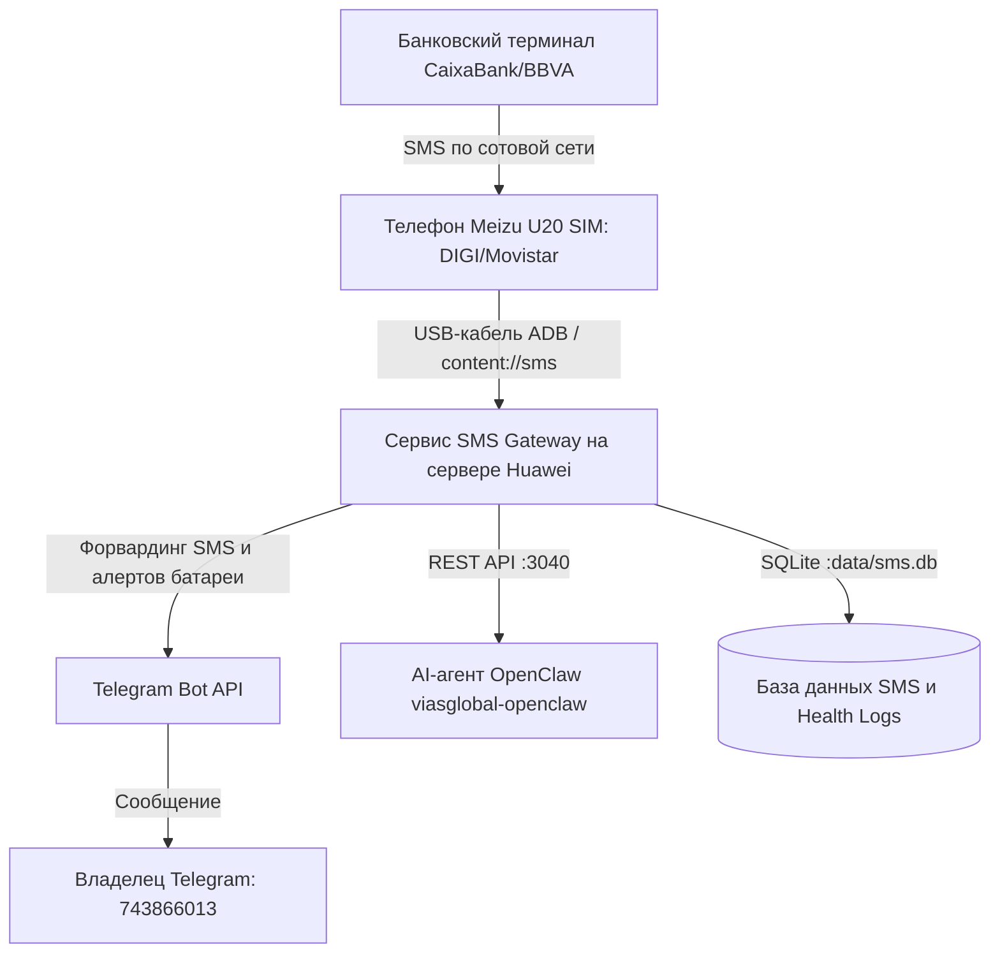

# Микросервис SMS Gateway (Приемник SMS с USB-телефона)

Автономный микросервис для чтения входящих SMS с мобильного телефона Android (Meizu U20), постоянно подключенного по USB-кабелю к домашнему серверу Huawei. Сервис форвардит полученные SMS владельцу в Telegram, непрерывно следит за здоровьем устройства (заряд батареи, статус питания, активность SIM-карты) и предоставляет REST API для автономного AI-ассистента **OpenClaw** (`viasglobal-openclaw`).

---

## 1. Зачем это нужно (Бизнес-контекст)

Арендаторы вносят арендную плату наличными через банковские терминалы самообслуживания в Испании (например, терминалы CaixaBank, BBVA, Santander). При внесении средств банк отправляет одноразовые проверочные коды, уведомления об авторизации транзакций и подтверждения зачисления на привязанный номер телефона.

Чтобы владельцу не нужно было постоянно носить с собой отдельный рабочий телефон:
1. Мобильный телефон (Meizu U20) **навсегда подключен по USB к серверу Huawei**.
2. Телефон непрерывно подзаряжается от USB-порта сервера.
3. Сервис **SMS Gateway** через ADB мгновенно считывает каждое входящее SMS.
4. Сообщение анализируется, сохраняется в локальную базу данных SQLite и пересылается владельцу в Telegram (`743866013`).
5. AI-ассистент **OpenClaw** имеет прямой HTTP доступ к истории и последним сообщениям, чтобы подтверждать платежи арендаторов в реальном времени.

---

## 2. Архитектура системы



---

## 3. Пошаговая инструкция по настройке телефона (Meizu U20)

Для того чтобы сервер Huawei мог взаимодействовать с телефоном через USB-кабель, на Meizu U20 необходимо один раз активировать режим **Отладки по USB**:

### Шаг 1: Активация меню «Для разработчиков»
1. Откройте **«Настройки»** (Settings) на телефоне.
2. Прокрутите вниз и перейдите в **«О телефоне»** (About phone).
3. Найдите строку **«Номер сборки»** (Build number) или **«Версия Flyme»** и быстро нажмите на нее **7 раз подряд**, пока на экране не появится надпись *«Вы стали разработчиком!»*.

### Шаг 2: Включение отладки по USB
1. Вернитесь в «Настройки».
2. Перейдите в раздел **«Спец. возможности»** (Accessibility) (в некоторых версиях Flyme: «Система» или «Дополнительно»).
3. Откройте пункт **«Для разработчиков»** (Developer options).
4. Включите главный переключатель вверху, затем активируйте тумблер **«Отладка по USB»** (USB debugging).
5. При появлении предупреждения нажмите **«ОК»** (Разрешить).

### Шаг 3: Авторизация сервера по ключу RSA
1. Подключите телефон USB-кабелем к серверу Huawei.
2. Разблокируйте экран телефона.
3. На экране появится системный диалог:
   > **Разрешить отладку по USB с этого компьютера?**
   > Цифровой отпечаток ключа RSA: `...`
4. **ОБЯЗАТЕЛЬНО** поставьте галочку: `[x] Всегда разрешать с этого компьютера` (Always allow from this computer).
5. Нажмите кнопку **«Разрешить»** (OK).

### Шаг 4: Рекомендованные настройки для работы 24/7
- **Не выключать экран при зарядке**: в меню «Для разработчиков» включите пункт *«Не выключать экран при зарядке»* (Stay awake), либо отключите автоблокировку экрана.
- **Энергосбережение Flyme**: в приложении *«Безопасность»* (Security) -> *«Питание»* переведите режим в *«Производительный»* или отключите агрессивный сон, чтобы система не отключала процессор при длительном бездействии.

---

## 4. Спецификация REST API (`http://sms-gateway:3040`)

Все ответы возвращаются в кодировке UTF-8 и содержат полную структурированную информацию согласно единому регламенту `docs/SERVICES.md`.

### 4.1. Проверка здоровья (`GET /health`)
- **Назначение**: Комплексная проверка работоспособности сервиса, статуса USB-подключения, уровня батареи, температуры и активности сотовой связи.
- **Пример вызова**:
  ```bash
  curl -s http://localhost:3040/health
  ```
- **Пример ответа**:
  ```json
  {
    "status": "ok",
    "message": "SMS Gateway и мобильный телефон функционируют в штатном режиме",
    "service": "sms-gateway",
    "uptimeSeconds": 3600,
    "device": {
      "connected": true,
      "serial": "U20AVCPM22MQH",
      "model": "Meizu U20",
      "manufacturer": "Meizu",
      "androidVersion": "6.0",
      "state": "device",
      "battery": {
        "level": 87,
        "isCharging": true,
        "temperature": 28.5,
        "voltage": 4150,
        "usbPowered": true
      },
      "sim": {
        "state": "READY",
        "operator": "DIGI mobil",
        "isReady": true
      }
    },
    "stats": {
      "totalSmsReceived": 14,
      "lastSmsTimestamp": 1730005000000
    },
    "lastCheckedAt": 1730005060000
  }
  ```

---

### 4.2. Получение последнего SMS (`GET /sms/latest`)
- **Назначение**: Быстрое получение самого свежего сообщения (используется OpenClaw для подтверждения внесения денег арендатором).
- **Пример вызова**:
  ```bash
  curl -s http://localhost:3040/sms/latest
  ```
- **Пример ответа (200 OK)**:
  ```json
  {
    "status": "ok",
    "message": "Последнее входящее SMS успешно получено",
    "data": {
      "id": 14,
      "androidId": "1042",
      "sender": "CaixaBank",
      "body": "Operacion terminal 450,00 EUR completada. Codigo autorizacion: 948271",
      "receivedAt": 1730005000000,
      "telegramSentAt": 1730005001200,
      "telegramMessageId": 78912,
      "createdAt": 1730005001000
    }
  }
  ```

---

### 4.3. Список входящих SMS (`GET /sms/list`)
- **Query-параметры**:
  - `limit`: количество сообщений (по умолчанию `20`, макс `100`).
  - `offset`: смещение для пагинации (по умолчанию `0`).
  - `sender`: фильтрация по отправителю (подстрока, например `Caixa`).
  - `search`: поиск по ключевому слову в тексте сообщения.
  - `since`: фильтр по времени в миллисекундах (`received_at >= since`).
- **Пример вызова**:
  ```bash
  curl -s "http://localhost:3040/sms/list?limit=5&sender=Caixa"
  ```

---

### 4.4. Принудительная синхронизация (`POST /sms/sync`)
- **Назначение**: Мгновенный принудительный опрос системной базы SMS через ADB без ожидания таймера поллинга.
- **Пример вызова**:
  ```bash
  curl -s -X POST http://localhost:3040/sms/sync
  ```

---

### 4.5. Прием сообщений по Webhook (`POST /sms/webhook`)
- **Назначение**: Позволяет сторонним Android-приложениям (SMS Forwarder, SMS Gate) пушить сообщения в сервис по HTTP.
- **Тело запроса (JSON)**:
  ```json
  {
    "sender": "CaixaBank",
    "body": "Ingreso en cajero 450 EUR",
    "timestamp": 1730005000000
  }
  ```

---

## 5. Система мониторинга и Telegram-алерты (Health Check)

Сервис непрерывно контролирует физическое состояние телефона и отправляет информативные уведомления в Telegram владельцу:

1. **Форвардинг входящих SMS**:
   - Красивое HTML-сообщение с указанием отправителя, точного времени по Мадриду (`Europe/Madrid`), текста сообщения в блоке цитаты.
   - Автоматическое распознавание и подсветка сумм в EUR (`450,00 EUR`) и кодов авторизации (`948271`).
   - Отображение текущего заряда батареи телефона прямо в заголовке сообщения (`⚡ 87%`).
2. **Алерт при отключении телефона (`🚨 ВНИМАНИЕ`)**:
   - Если USB-кабель случайно задели или телефон перезагрузился, бот немедленно сообщает об отключении устройства.
3. **Алерт при восстановлении связи (`🟢 Телефон на связи`)**:
   - Уведомление о том, что телефон снова обнаружен и готов к приему SMS.
4. **Алерт при низком заряде батареи (`🪫 ВНИМАНИЕ: заряд ниже 15%`)**:
   - Если батарея реально разряжается или перестал поступать ток зарядки от порта USB.
   - **Защита от ложных срабатываний**: Значения 0% при высоком напряжении аккумулятора (> 3500 мВ) отфильтровываются как временный сбой контроллера при перезагрузке; перед отправкой выполняется контрольная перепроверка через 3 секунды.
   - Предупреждения отправляются не чаще одного раза в 30 минут для защиты от спама.
5. **Оповещение о восстановлении питания (`🟢 Питание восстановлено`)**:
   - Если ранее был выслан алерт о разряде, а затем возобновилась зарядка по USB или уровень поднялся выше порога, сервис автоматически отправляет подтверждение восстановления.
6. **Оповещение о перезагрузке телефона (`🔄 Телефон перезагрузился`)**:
   - Сервис контролирует время непрерывной работы ядра (`/proc/uptime`). При обнаружении сброса аптайма после сбоя или перезагрузки бот отправляет подтверждение, что система Android поднялась и готова принимать SMS.
7. **Периодический отчет о здоровье системы (`POST /health/alert`)**:
   - Сводный статус устройства, оператора связи и счетчика принятых сообщений.

---

## 6. Управление сервисом через Makefile

```bash
# Запуск автотестов
make test

# Сборка и фоновый запуск Docker-контейнера
make up

# Просмотр логов в реальном времени
make logs

# Проверка текущего статуса здоровья
make status

# Просмотр последнего полученного SMS
make latest

# Принудительная синхронизация с телефоном
make sync

# Остановка контейнера
make down
```

---

## 7. Файлы и связанные модули

- Конфигурация: [config.ts](file:///Users/usuario/code/viasglobal/sms-gateway/src/config.ts)
- База данных SQLite: [database.ts](file:///Users/usuario/code/viasglobal/sms-gateway/src/db/database.ts)
- Клиент ADB: [adb-client.ts](file:///Users/usuario/code/viasglobal/sms-gateway/src/device/adb-client.ts)
- Парсер вывода ADB: [adb-parser.ts](file:///Users/usuario/code/viasglobal/sms-gateway/src/device/adb-parser.ts)
- Монитор здоровья: [health-monitor.ts](file:///Users/usuario/code/viasglobal/sms-gateway/src/health/health-monitor.ts)
- Поллер SMS: [sms-poller.ts](file:///Users/usuario/code/viasglobal/sms-gateway/src/device/sms-poller.ts)
- Telegram нотификатор: [telegram-notifier.ts](file:///Users/usuario/code/viasglobal/sms-gateway/src/telegram/telegram-notifier.ts)
- REST API маршрутизатор: [routes.ts](file:///Users/usuario/code/viasglobal/sms-gateway/src/api/routes.ts)
- HTTP сервер: [server.ts](file:///Users/usuario/code/viasglobal/sms-gateway/src/api/server.ts)
- Точка входа: [index.ts](file:///Users/usuario/code/viasglobal/sms-gateway/src/index.ts)
- Правила для ИИ: [AGENTS.md](file:///Users/usuario/code/viasglobal/sms-gateway/.agents/AGENTS.md)
